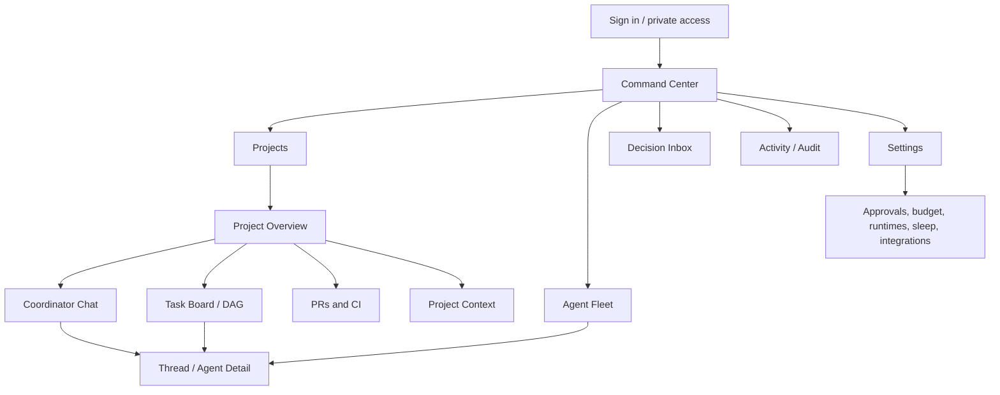

# Experience IA and navigation principles

App is organized by **Projects**, not by raw terminal session. An agent is a worker on an objective; its terminal is an inspectable implementation detail.

## Shared building blocks

Project switcher, persistent status summary, command composer, decision badge, task detail drawer/sheet, source-linked context viewer, agent roster, provider capacity, PR reviewer, audit trail, global search, system-health banner.

## Global actions

Create project, upload context, send goal, pause/resume project, toggle sleep mode, see approvals, inspect/stop agent (policy controlled), adjust concurrency/budget ceiling, open GitHub PR, view safe-run evidence.

## Navigation rules

- One global header on desktop; compact title + project switcher on mobile.
- Critical approvals and runtime failures surfaced separately from normal inbox chatter.
- Project pages cross-link to task, attempts, worktrees, messages, commits, PRs.
- Every status presents timestamp and source-of-truth so stale data is identifiable.
- Responsive, keyboard accessible; bottom tabs on Android narrow screens, not a desktop sidebar squeezed smaller.
