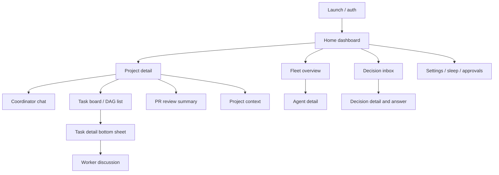

# Android / narrow-web app map

## Proposed bottom tabs

1. **Home** — project summary, newest verified achievements, blocked items, next actions.
2. **Projects** — project list; project screen opens Chat / Tasks / Agents / PRs / Files via segmented subtabs.
3. **Inbox** — one human decision queue; filters: Needs me, FYI, Approved, Archived.
4. **Fleet** — active agents with concise state, model, task, last heartbeat, intervene action.
5. **More** — preferences, sleep, budgets, integrations, audit, diagnostics.

## Hierarchical screens

## Mobile-specific interaction rules

- Use cards and hierarchical lists, not wide tables; DAG becomes collapsible dependency list.
- Sticky bottom command composer in coordinator chat; file attachment uses system picker.
- Decision cards show recommended answer, risk, why blocked, and exactly what approval changes.
- Sleep toggle is persistent; highlight 'queued decisions, still running safely' rather than 'everything paused'.
- Large tap targets, robust offline/reconnect display, deep links to project/task/inbox item.
- Background push notification via Android build only after auth and delivery semantics validated. Web/PWA may use browser notifications where available.
- Android native layer should be a Capacitor app built from shared responsive React source; do not write a duplicate mobile product or simply point a WebView at the Vercel URL.
- Test native login flow/deep links, secure session expiry, lifecycle handling, file uploads and notifications. Release via the owner's Google Play Console internal testing first; publishing is later, not part of the specifications commit.

## Mobile acceptance walkthrough

At 360×800 and 412×915, owner can launch new task, attach context, send coordinator message, see live progress, toggle sleep, answer one question, review PR summary and inspect failure without horizontal scrolling.
