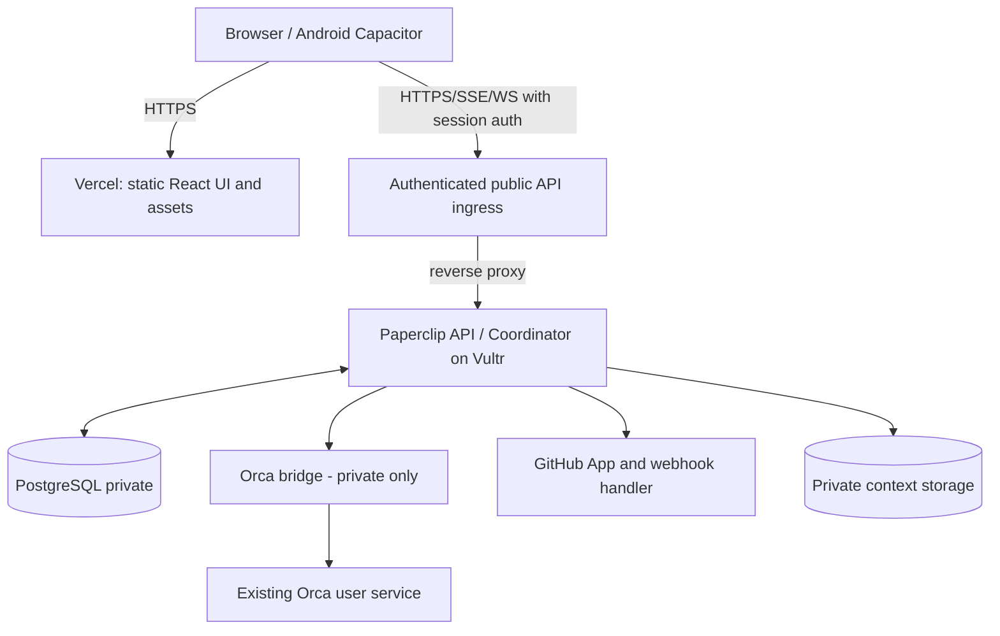

# Deployment architecture — Vercel web, Vultr services, Google Play Android

**Status:** chosen target, **not yet proven** with the pinned Paperclip build. See [ADR-0006](../08-decisions/ADR-0006-vercel-and-android.md).

## Topology (two-step rollout)

### Alpha v0.1: safe single-origin proof

- Existing `systemctl --user` Orca service remains running as-is on Vultr. No restart or authentication reset.
- Self-host Paperclip server, its bundled UI and PostgreSQL as a **separate** stack on Vultr for the first real dispatch; `authenticated/private` over Tailscale until external auth design is validated.
- `orca-bridge` runs under the Orca-owning Linux user and binds loopback or Unix socket, authenticated and permission-scoped.
- Validate the CLI with a disposable Muse worker and track task/attempt/worktree correlation.
- This single-origin stage is **temporary** and avoids exposing an unverified authentication surface to the Internet.

### Target v0.2+: split Vercel UI + Vultr API

- **Vercel:** Vite/React production assets, previews for PRs, build/deploy pipeline, compatible same-origin routing only if it passes all auth/realtime tests. No persistent agents, orchestrators, websockets servers or databases in Vercel Functions.
- **Vultr:** Paperclip long-running backend, scheduler, event consumers, GitHub webhook receiver, PostgreSQL, context file store, Orca bridge, worker processes. Node runtime pinned to supported Paperclip requirements.
- **Ingress:** public **HTTPS** API endpoint with TLS, WAF/rate limiting, strictly scoped origins and authenticated requests. The bridge must remain private/loopback. Choose same registrable domain for frontend and API (`app.example.com` / `api.example.com`) to simplify cookie and session semantics. No real domain name is assumed yet.
- **Tailscale:** secure operator SSH/admin and private worker-host communication. A Vercel-hosted browser cannot reach Tailscale-only API endpoints without a supported ingress/tunnel pattern. Do not falsely claim Vercel static hosting works with a tailnet-only API.
- **GitHub:** webhook signature validation, replay protection and exact PR head SHA gates. Only public webhook path required; never expose Orca CLI directly.
- **Android:** Capacitor package of **shared web source**, not merely a WebView to the deployed website. Device reaches the authenticated public backend through normal HTTPS, while host administration remains private.

## Blocking frontend separation spike (E01 + E12 + E17)

Paperclip upstream currently has a Vite React UI package and a Node server, but its **supported deployment** defaults to bundling the UI with the backend. Do not assume splitting it works without changes. Prototype a Vercel preview before declaring the target available:

1. Pin upstream Paperclip SHA, build `ui` independently with its workspace dependencies, and verify client-side routing on page refresh.
2. Test API base URLs, CORS, cookies, CSRF, OAuth/Better Auth login/logout/callbacks, domain + SameSite/Secure settings and ability to authenticate via the Android app.
3. Test streaming: SSE, WebSocket or equivalent; test 15+ minute sessions and reconnect, Vercel preview deployment URLs and origins.
4. Test uploads, file preview/download, callback redirects, reverse-proxy headers, pagination and GitHub webhook ingress.
5. Validate configuration: browser-safe settings only in Vercel; *no* GitHub App keys, DB URLs, service tokens or CLI credentials in Vercel/browser bundles.
6. If Paperclip's current UI cannot run separately, retain Vultr-hosted UI for v0.1 and create an incremental frontend-compatible API/BFF plan. Do not rewrite auth or abandon Paperclip opportunistically.

## Configuration catalog (names, not secrets)

**Vercel:** `VITE_PUBLIC_API_URL` (only an HTTPS public URL), deployment project/root directory, preview/production hostname routing, build preset based on pinned upstream. Browser env vars are **public** by design.

**Vultr:** `PAPERCLIP_DATABASE_URL`, `PAPERCLIP_PUBLIC_URL`, `PAPERCLIP_DEPLOYMENT_MODE`, `BRIDGE_BIND`, `BRIDGE_AUTH_SECRET`, `ORCA_CLI_COMMAND`, `ORCA_CONFIG_DIR`, `GITHUB_APP_ID`, `GITHUB_APP_PRIVATE_KEY_PATH`, `GITHUB_WEBHOOK_SECRET`, `CONTEXT_STORAGE_URI`, `MAX_ACTIVE_WORKERS_GLOBAL`, `MAX_ACTIVE_WORKERS_PER_PROJECT`, `MONTHLY_BUDGET_USD`.

Keep secrets in a secret manager or restricted service environment. Never commit values, print them into PR logs or send them to workers.

## Provisioning and release sequence

1. Inventory Vultr CPU/RAM, Orca service and CLI read-only; record supported versions. Back up critical configs securely, without copying secrets into docs.
2. Deploy a **separate** pinned Paperclip + PostgreSQL stack to the VPS, test private access and isolated data.
3. Deploy bridge to loopback with service identity, health checks and no-new-dispatch kill switch; test disposable worker.
4. Start Vercel preview-only builds of the standalone UI. Do not enable production traffic until auth/realtime/API-origin tests pass.
5. Provision stable frontend/API domains with TLS, limit public endpoints, put Paperclip into authenticated public exposure mode after threat-review.
6. Validate end-to-end login, goal submission, worker status, event stream, upload, PR review and notifications from Vercel frontend. Ensure previews cannot access production secrets or mutate production without explicit approval.
7. After reliable mobile browser UX, package Capacitor Android AAB, test on physical Android device, and publish initially through Google Play internal testing.

## Backup, rollback, ongoing operations

Daily database and context backups with test restores; pinned builds; rolling backend restart only after fencing leases; alert on ingress, webhook and queue failures. Roll back Vercel frontend independently of backend **only within tested API contract compatibility**. Never roll back or restart the user's Orca service blindly as part of ForgeFleet release.
