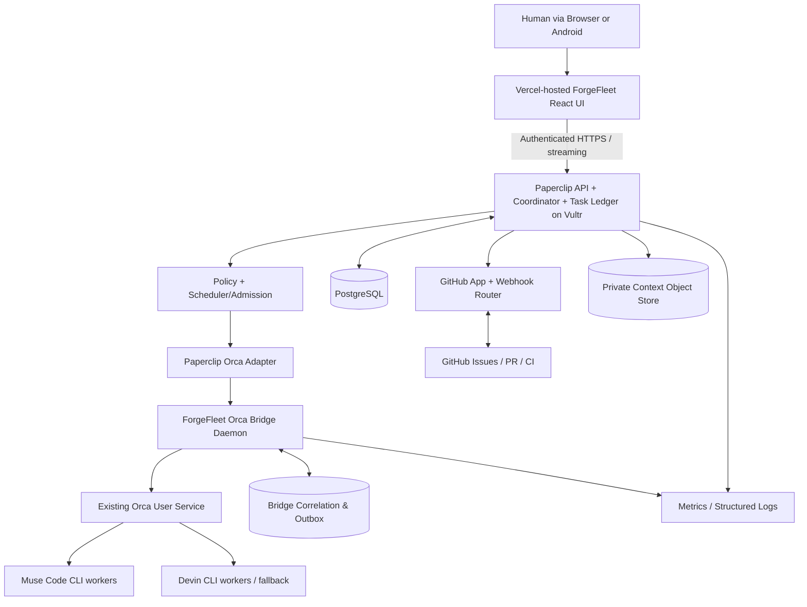

# System architecture and authority boundaries

**Decision:** [ADR-0001](../08-decisions/ADR-0001-control-plane.md) and [ADR-0002](../08-decisions/ADR-0002-execution-adapter.md). The architecture is intentionally incremental.



## Authority table

| Object/action | Authoritative owner | Notes |
|---|---|---|
| Goal, project, task, dependency, approval | Paperclip control plane | API contract/version pinned |
| Desired dispatch count / assignment | Deterministic scheduler and task leases | Coordinator proposes; policy authorizes |
| Runtime worker process, agent terminal, Orca worktree | Orca | Never write Orca DB directly |
| Cross-system IDs, webhook receipts, idempotency | ForgeFleet bridge store | Outbox/inbox and fencing |
| Git branches/PR/checks/merge truth | GitHub | Webhook ingestion + periodic reconciliation |
| Context files and versions | Context store + metadata | Source references immutable per task attempt |
| Human authority/approvals | Policy service + audited owner action | Never infer from an AI message |

## Component boundaries

**UI:** authenticated presentation and user commands, no raw shell or GitHub tokens. **Coordinator:** text reasoning and plan suggestions, no direct privilege escalation. **Scheduler:** task readiness, dependency DAG, admission, lease and retry. **Bridge:** authenticated RPC to Orca CLI, source-normalized events, durable mapping, timeouts and read-only discovery. **GitHub service:** installation token, webhook validation and allowed PR actions. **Storage:** task state and credentials segmented; uploaded context scanned/sanitized.

## Integration rules

- Bridge methods may be requested only by scoped backend identity, not from browser or raw worker prompts.
- Paperclip HTTP adapter is appropriate for **proof of concept**, but a persistent native adapter is expected for event streaming, session continuity and reliable workspace lifecycle.
- Paperclip adapter has a **no-remote-git-as-persistence** rule: preserve local cwd across heartbeats and sync work from Orca after dispatch. GitHub PRs are deliverables, not the only state carrier.
- Two supervisors cannot both own/restart a worker. Define explicit ownership per attempt; Paperclip controls desired state, Orca controls the actual process. Recovery reconciles rather than blind relaunch.
- Do not depend on undocumented Orca internal sockets or daemon endpoints.

## Source layout (future implementation)

```text
apps/web                  # forked/extended Paperclip UI entry; Vercel build only after separation spike
apps/android              # Capacitor Android for Play Console (later)
services/orca-bridge      # TypeScript Linux daemon
packages/bridge-contracts # generated schemas/client
packages/policy           # deterministic authorizations
packages/telemetry        # common event/trace helpers
packages/ui               # shared ForgeFleet components (if needed)
integrations/github       # GitHub App/webhook module
infra/                    # compose, systemd, deployment manifests
```

Not all these directories exist yet. They are module ownership targets, not promises about how Paperclip's upstream monorepo is internally organized. Decide fork vs composition after upstream compatibility spike.
