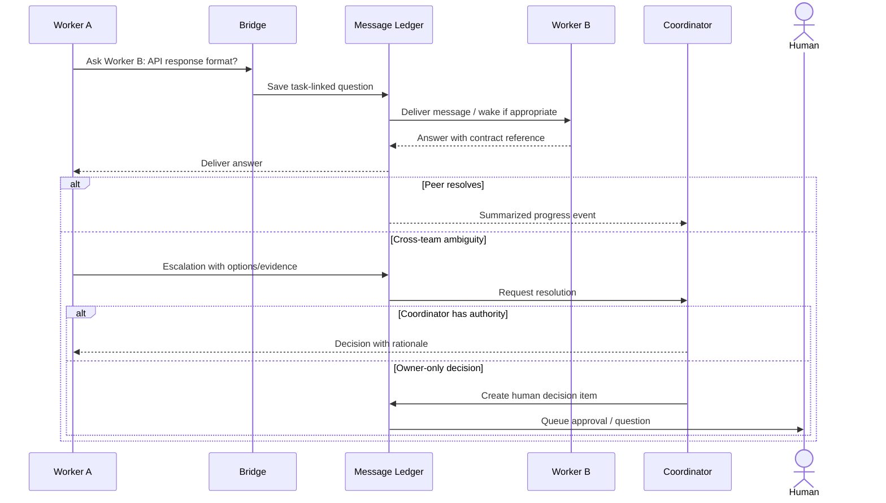

# F02: Worker communication, questions and sub-delegation

## Contract

Each message has unique ID and task/thread correlation; receipt acknowledged after persistence; recipient may be individual worker, lead, coordinator, owner or allowed group. Questions need deadline/severity. Agent-to-agent messages do not modify tasks or authority automatically; follow-up actions use separate typed API calls.

## Subdelegation

Lead can recommend spawning child tasks/agents, but the scheduler accepts only if within scope, budget, and DAG validity. A child worker inherits only minimal context and permissions. The root coordinator can revoke task claims or transfer ownership; cancellation must be reconciled with actual Orca process.

## No answer behavior

If peer unavailable or message expires, route to lead/coordinator. If human absent, block only dependent task. A blocked task may move back to ready after a reply; maintain original message and answer audit.
