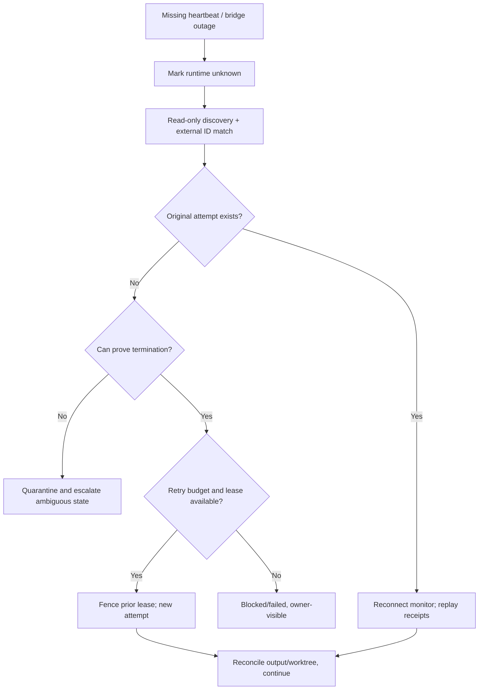

# F05: Failures, retries, agent replacement and crash recovery

## Failure cases to inject

- Kill bridge immediately after Orca accepted launch but before response persisted.
- Restart Paperclip while 3 workers are active.
- Simulate Orca unavailable for 10 min without killing workers.
- Disconnect GitHub webhook for one PR then restore.
- Duplicate every runtime message 3 times and reorder them.
- Fail Paperclip workspace sync-back after a successful Orca commit.
- Change PR head between human approval and merge request.
- Provider rate-limit worker mid-task; preserve context and notify capacity.
- Owner asleep with two questions while unrelated tasks finish.

## Recovery acceptance

No double-spawn, no double-merge, no lost question, no leaked active worktree, no false 'verified'. Every irrecoverable ambiguity becomes an auditable blocked incident with a clear next action.
