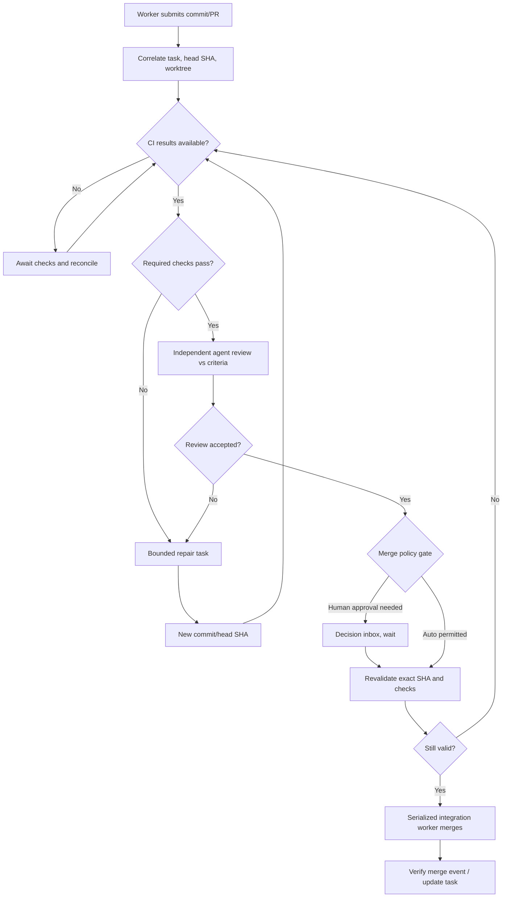

# F03: Worker submission → CI → independent review → merge

## Important semantics

Approval binds to `repoId`, `prNumber`, `headSha`, `targetBranch` and policy version. New commits invalidate approval. Failed checks on old heads do not override new results. 'Reviewed by agent' is evidence, not automatically a privileged permission.

## Integration conflict

Merge coordinator serializes PRs touching the same branch. Conflicts create integration tasks; workers do not force push or arbitrarily choose winning code. Repo branch protections remain authoritative even if local policy misconfigured.

## No-PR tasks

Documentation/research tasks may complete via verified artifact; task acceptance criteria explicitly declare whether PR is mandatory. Never force fake PRs to satisfy the workflow.
