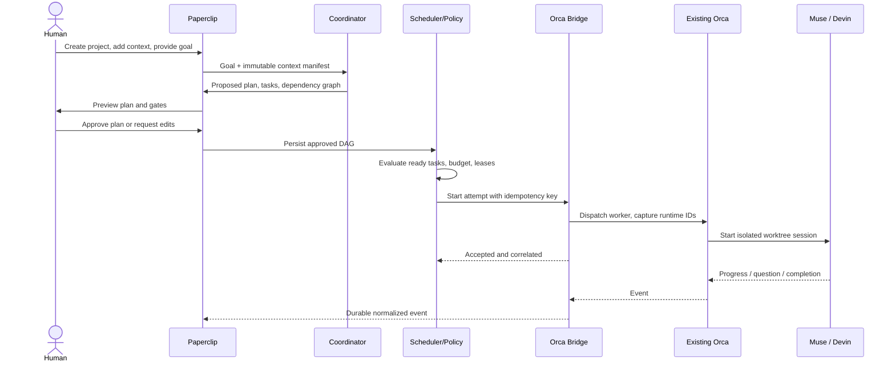

# F01: Human goal → coordinator DAG → agent dispatch

## Subflow A: planning

Coordinator reads repository topology/context hashes, creates scoped tasks with acceptance evidence and constraints, labels dependencies, chooses capable agent types and estimated cost. DAG validator rejects cycles and duplicate ownership. Tasks cannot be dispatched until plan acceptance policy is met.

## Subflow B: admission

The scheduler checks independent blockers, resource availability, workspace lease, provider limits, project pause, owner decisions and risk class. If denied, task remains ready/blocked with human-readable reason rather than disappearing.

## Subflow C: launch

Bridge stores dispatch request before issuing command; uses fixed/origin-validated CLI executable; records Orca IDs/attempt mapping; starts event monitor. Network error after issue -> reconcile original dispatch by correlation before replay.

## Subflow D: finish

Worker posts artifact/PR link and tests. Runtime completion != task verified. Reviewer and CI assess evidence, then coordinator advances task state. A dependent task wakes only when its relevant prerequisite is satisfied.
