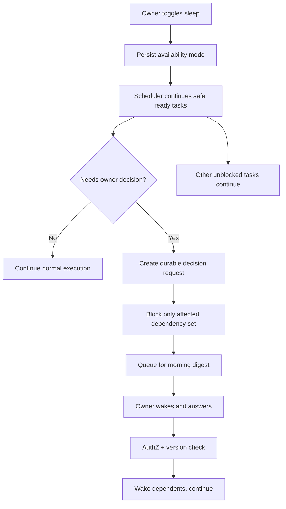

# F04: Sleep mode, pending decisions and digest

Owner availability is preference, not authorization. Sleeping mode never changes merge rules; no timeout auto-approvals. Critical incident policy may permit urgent notification, not unapproved action. Pausing a project differs from sleeping: pause stops *new dispatch* (and optionally signals current runs after policy confirmation), while sleep only changes human interruption behavior.

## Decision item fields

Project, task, requester, category, severity, evidence/citations, options, recommended option, impacted tasks, cost/risk, `requires_owner`, expiration, approval target hash and status. Answer must be signed by authenticated owner, not inferred from text in GitHub issue.

## Morning digest

Verified delivered outcomes, failed/retrying attempts, new PRs, current active worker count, waiting capacity and costs, pending decisions ordered by blast radius. No 200 separate notifications for 200 worker progress updates.
