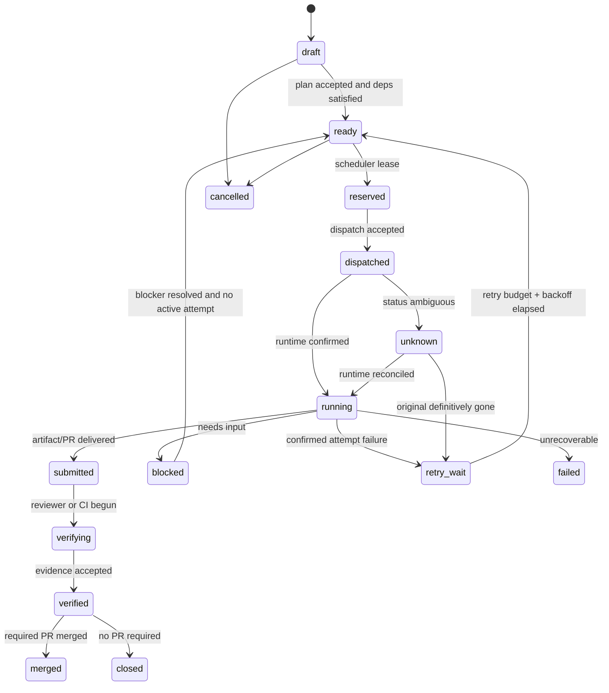

# Formal states, transitions and invariants

## Task machine

No `unknown -> ready` without proving old attempt gone/fenced. `verified` != `merged` when merge is part of acceptance.

## Attempt machine

`requested -> accepted -> dispatching -> running -> finished | failed | cancelled`; `dispatching/running -> unknown` on telemetry loss, then reconcile to former or terminal state. `finished` means runtime ended, *not* code accepted. Exactly one current authorized lease per task; there can be many historical attempts.

## Decision machine

`proposed -> pending -> answered | withdrawn | expired`; an expired `OWNER_REQUIRED` approval does not grant authority. An answer against a changed target SHA is invalid and reopens the decision.

## Worker machine

`available -> assigned -> starting -> busy -> reporting -> available`; orthogonal `disconnected`, `quarantined`, `retiring`. Agent identity persists across sessions, but a task's active attempt has one runtime owner.

## Invariants

- At most one active fenced attempt per task; generation monotonic.
- Every external mutation has idempotency key and actor identity.
- No PR merge without policy authorization at the **current head SHA**.
- No dependency advances on `attempt.finished` alone.
- No task completion when workspace finalization failed.
- 'unknown' renders as unknown; not stopped/failed/healthy.
- Sleep mode may suppress noncritical alerts but cannot change approval outcomes.
