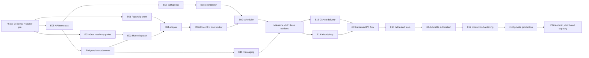

# Build dependency graph and integration checkpoints

## Hard integration gates

- G0: contract owner accepts API/event schema and field meaning.
- G1: bridge verifies exact version-matched installed Orca executable and safe command arguments.
- G2: one Muse attempt starts and returns exact durable IDs.
- G3: original attempt safely reconciled after injected bridge restart.
- G4: three-worker task graph completes with nontrivial dependency and peer message.
- G5: GitHub PR review/CI/head SHA gates pass; `main` remains owner-protected.
- G6: owner sleep mode allows independent work while queuing questions.
- G7: finalization recovery and no-side-effect duplication across restarts.
- G8: security, backup/restore, performance and acceptance signoff.

## Risk register

| Risk | Probability / impact | Mitigation |
|---|---|---|
| Paperclip/Orca both own worktree | high/high | Explicit workspace contract and finalize test |
| CLI behavior differs by installed Orca version | high/medium | Version-matched skill, capability adapter |
| Devin unsupported supervised launch | medium/medium | Terminal dispatch fallback, capability status |
| 20 engineers edit same UI bootstrap | high/high | Path ownership, integration lead |
| Agent prompt injection from repo | high/high | Policy engine gate and secrets isolation |
| VPS resource exhaustion | medium/high | Low initial active limit, admission metrics |
| Missing event after crash | medium/high | Inbox/outbox, reconciliation |
| Paperclip upstream changes quickly | high/medium | Pin commit, integration tests, upgrade schedule |
